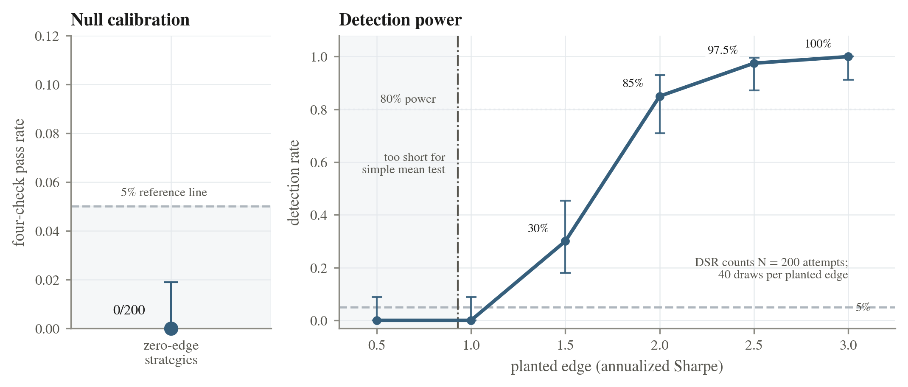
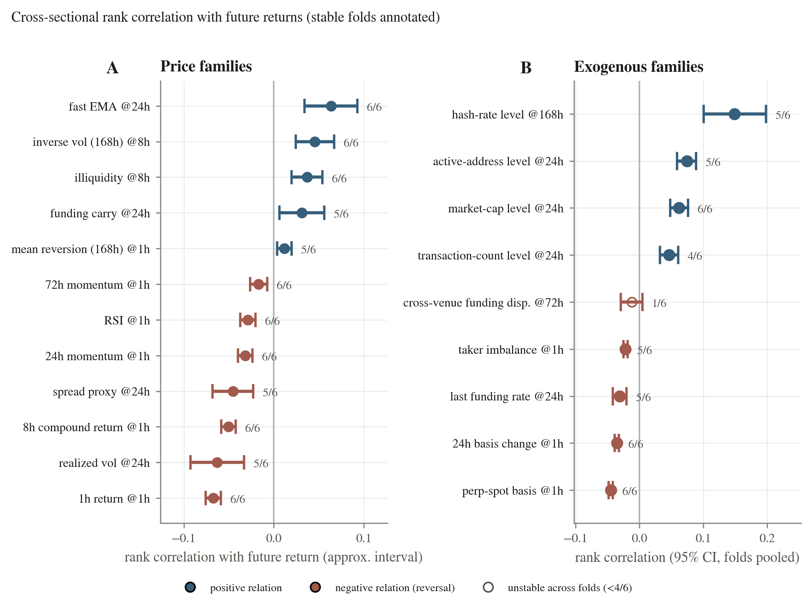

# Catch Alpha

**Testing the evaluator before testing the trading strategy.**
Code, results and figures for the ICAIF '26 poster paper by [Joris Viaud](https://jorisviaud.com).

[Paper (ACM DL)](https://doi.org/10.1145/3858063.3858682) ·
[Paper (PDF)](paper/catch_alpha_icaif26.pdf) ·
[Poster (PDF)](paper/catch_alpha_poster.pdf) ·
[Project page](https://jorisviaud.com/papers/catch-alpha) ·
[Reproduction tutorial](docs/TUTORIAL.md) ·
[Paper ↔ code map](docs/PAPER_MAP.md)

> **TL;DR.** Try enough trading ideas and one of them will look great on past data, even if
> none of them works. We built an evaluator that counts every attempt and refuses to rule
> when the data are too short, and **we tested the evaluator first**: on simulated markets
> with no real edge it accepted 0 of 200 strategies (and none under the other null
> processes we tested), and it detected planted edges once they were large enough. We then used it to audit offline RL on a market with a known signal,
> and four real strategies on twelve crypto perpetual futures. The data contain predictive
> patterns, but no tested portfolio produced a reliable net profit after fees.



---

## Contents

1. [The idea in one minute](#the-idea-in-one-minute)
2. [Results at a glance](#results-at-a-glance)
3. [Quickstart](#quickstart)
4. [What is in this repository](#what-is-in-this-repository)
5. [Using the evaluator on your own strategy](#using-the-evaluator-on-your-own-strategy)
6. [How we checked that this code reproduces the paper](#how-we-checked-that-this-code-reproduces-the-paper)
7. [Next extensions](#next-extensions)
8. [Citation](#citation)

---

## The idea in one minute

Most backtests answer *"how good does this strategy look?"*. Catch Alpha answers a
different question first: *"would my evaluation procedure have caught a strategy with no
edge?"* A candidate is accepted only if **all** of these hold, with every threshold fixed
before the run:

| # | Check | What it guards against |
|---|-------|------------------------|
| 0 | **Enough data.** At least `n ≥ ((z₀.₉₅ + z₀.₈₀)/S_min)² · P` observations (54,160 hourly bars for an annual Sharpe of 1). Otherwise the verdict is `INSUFFICIENT_DATA` and no Sharpe is reported. | Ruling on samples too short to tell skill from luck |
| 1 | **Intervals above the benchmark.** Stationary-bootstrap 95% lower bounds of the excess mean *and* excess Sharpe are > 0. | Serial dependence, fat tails |
| 2 | **Credible after counting attempts.** Deflated Sharpe ratio ≥ 0.95, with the number of trials *N* read from an append-only **trial ledger**. | Picking the best of many tries |
| 3 | **Better than every baseline.** Worst pairwise SPA p-value ≤ 0.10. | Beating only a weak straw man |
| 4 | *(diagnostic)* **Probability of backtest overfitting** ≤ 0.50. A missing strategies × folds matrix blocks acceptance, but a low value cannot by itself establish profitability. | Selection that does not survive out of sample |

Access to the final (holdout) period is rationed: at most three evaluations were allowed,
and the paper uses one.

## Results at a glance

**1. The evaluator, on synthetic data with known truth** ([Figure 1](figures/F1_null_calibration.png)).

| Setting | Accepted |
|---|---|
| 200 Gaussian zero-edge strategies (N = 200 trials) | **0 / 200** (Wilson 95% upper bound 1.9%) |
| Student-t₃, GARCH(1,1), AR(1) and Gaussian nulls at 1,800 / 5,000 / 50,000 obs. | 0 / 2,400 |
| Planted annual Sharpe 0.5 / 1.0 / 1.5 / 2.0 / 2.5 / 3.0 (40 draws each) | 0 / 0 / 30 / 85 / 97.5 / 100 % |
| Selection among 200 correlated candidates, uncorrected test | 48–100 % of zero-edge winners accepted |
| Same winners, the four checks with N = 200 | 1 / 1,500 |
| Same winners, plain t-test on an untouched holdout | 5.0–7.6 %, with more power (86 % vs 24.5 % detection at Sharpe 1.5) |

These rates hold for the generators and sample sizes tested; they are not a universal
false-positive rate. When a clean single-use holdout exists, testing on it is the cheaper
correction.

**2. Can offline RL use a known signal?** ([Figure 2](figures/F2_capability_curve.png))
Five simulated assets with a planted predictor (information coefficient 0.05); the
Gârleanu–Pedersen (GP) rule is the analytic reference; 9 configurations × 10 training
seeds × 100 fresh evaluation paths, every policy starting flat.

| | BC | IQL | CQL |
|---|---|---|---|
| No cost: median score relative to GP (≥ 0.50 required) | **0.900** | **0.731** | 0.335 (fails) |
| Quadratic costs (λ = 1): median mean profit | −0.995 | −4.036 | not adjudicated |
| Fits that lose money with costs | 10 / 10 | 10 / 10 | – |
| Median turnover relative to GP | 6.03× | 11.97× | – |

GP earns +0.0461 per path with costs. Feeding BC its previous position does not help
(−0.960, 10/10 negative, 5.92× turnover). GP is a risk-adjusted reference, not the exact
profit optimum, and the result concerns these configurations, not offline RL in general.

**3. Twelve Binance perpetual futures, hourly, 2019 – June 2026**
([Figure 3](figures/F3_signal_atlas.png), [Figure 4](figures/F4_fee_sensitivity.png)).

| Question | Result |
|---|---|
| Does short-horizon momentum predict returns? | Rank IC of 24h momentum vs next hour **−0.032**, stable in 6/6 folds → reversal, not momentum |
| Does the long-loser / short-winner tail portfolio make money? | **No**: −1.45 (24h) and −3.02 (8h) *before* costs |
| Can the three tested carry constructions keep the funding income after a 5 bp taker fee? | Funding is positive in 6/6 folds, but cash-and-carry nets **−0.263** (+0.491 funding, −0.023 basis, −0.732 fees); break-even fee ≈ 3.2 bp per leg |
| Did the single look at the 2025–26 holdout change anything? | No interval clears zero; 12,648 hours is below the 54,160 required, so smaller effects remain unresolved |



## Quickstart

Python ≥ 3.11.

```bash
git clone https://github.com/JorisViaudQuantAI/Catch-Alpha.git
cd Catch-Alpha
pip install -e ".[dev]"          # numpy, scipy, pandas, matplotlib (+ pytest, ruff)

python scripts/verify_paper_numbers.py   # check every headline number (seconds)
python scripts/make_figures.py           # redraw paper Figures 1-4 (+ figures S1, S2)
pytest                                   # unit tests
```

Then rerun the experiments themselves, from the cheapest to the most expensive. Each
command rewrites its file in `results/` (the learning test writes to `results/learning/rerun/`
and prints its numbers next to the paper's), so `git diff` tells you whether you reproduced
the published numbers:

```bash
python scripts/calibrate_evaluator.py null --workers 4        # Figure 1, a few minutes
pip install -e ".[learning]"                                  # adds PyTorch (CPU is fine)
python scripts/learning_test.py run --workers 4               # Figure 2, retrains 90 policies
pip install -e ".[data]"                                      # pyarrow, for the parquet files
python scripts/real_data_build_panel.py --lake-dir data/lake --out-dir data/public_v3 --spot  # ~1 h, 2-3 GB
python scripts/real_data_strategies.py --panel-dir data/public_v3 --spot-lake data/lake/binance_spot
```

The real-data scripts need the hourly panel, which `real_data_build_panel.py` rebuilds
from public Binance data: it downloads candles and funding history into a local parquet
cache (`data/lake/`) and assembles the panel (`data/public_v3/`). The
[tutorial](docs/TUTORIAL.md) walks through every step, with run times.

## What is in this repository

```
src/catch_alpha/
  stats.py           power gate, stationary bootstrap, DSR, SPA, PBO, Wilson intervals
  gate.py            the evaluator: evaluate(candidate, benchmark, baselines, ...)
  ledger.py          append-only trial ledger with a final-period access budget
  calibration.py     Section 2 experiments: nulls, planted edges, selection, true-V check
  learning/          Section 3: planted-alpha market, GP reference, BC/IQL/CQL, 9-arm design
  realdata/          Section 4: Binance download, panel, signals, the four frozen strategies
scripts/             one command per experiment, plus make_figures.py and verify_paper_numbers.py
results/             every number in the paper, as CSV/JSON (the files the figures are drawn from)
figures/             paper Figures 1-4 (F1-F4), supplementary S1-S2, a poster preview
paper/               the paper (final ACM version) and the poster
docs/                TUTORIAL.md (reproduce from scratch), PAPER_MAP.md (claim -> code -> file)
tests/               unit tests, including exact-value regression tests against the paper
```

This repository is a cleaned-up extraction of the paper-specific parts of a larger
research codebase. Only the code paths that produce the published numbers were kept; their
random-number order was preserved so that every seed gives the same result as the
original. Identifiers such as `H104` or `E240` in file names and result files are
experiment IDs from the original research log, and `public_v3` is the name of the
real-data panel.

## Using the evaluator on your own strategy

```python
import numpy as np
from catch_alpha.gate import evaluate
from catch_alpha.ledger import TrialLedger

ledger = TrialLedger("my_ledger.json")
ledger.record(
    dataset_id="my_panel",
    split="valid",
    metric_family="sharpe",
    experiment_id="momentum_v1",
    code_version="v1",  # defaults to the current git commit
)

verdict = evaluate(
    candidate=my_strategy_returns,  # per-period net returns
    benchmark=np.zeros_like(my_strategy_returns),  # e.g. cash
    baselines={"buy_and_hold": bh_returns, "momentum": mom_returns},
    periods_per_year=8760,  # hourly
    n_trials=ledger.n_trials("my_panel"),  # every selection attempt counts
)
print(verdict["status"], verdict["all_pass"], verdict["checks"])
```

`evaluate` returns `INSUFFICIENT_DATA` when the sample is too short; that is a result,
not an error. Record every evaluation in the ledger, including the ones you would rather
forget: the deflated Sharpe ratio is only as honest as `n_trials`.

## How we checked that this code reproduces the paper

Every number this repository ships must equal the number in the paper and in the original
research code. We checked it at three levels.

1. **Same functions.** The new evaluator, learners and strategy code were run side by
   side with the original implementation on the same inputs. The evaluator's output is
   identical field by field; the learning test is bit-identical on every evaluation path
   of every arm checked; the strategy return series are bit-identical.
2. **Same experiments.** The experiments were rerun from scratch with the new code and
   compared with the published files:

   | Paper result | Rerun with this code |
   |---|---|
   | Figure 1: 0/200 nulls; 0/0/30/85/97.5/100 % detection | identical (`results/calibration/null_calibration.csv`) |
   | DSR variance check: V = 4.6×10⁻⁴ vs 5.6×10⁻⁴; DSR 0.99 vs 0.63 | identical to the last digit |
   | Table 1 (selection among correlated candidates) | 36 campaigns covering all 12 experiment cells (Table 1 prints 5 columns): identical winners and verdicts (full run ≈ 3 CPU-hours, not repeated) |
   | Null robustness grid | 16 seeds: identical Sharpe ratios (full grid not repeated) |
   | Figure 2: 0.900 / 0.731 / 0.335; −0.995 / −4.036; 6.03× / 11.97×; GP +0.0461 | report and figure data rebuilt from the 90 published runs: identical decisions and figure data (floats agree to ~1e-15 across numpy versions). All 90 policies retrained: same numbers to the printed precision, same decisions (see note) |
   | Figure 3, price panel: 69/128 stable pairs, 24h momentum IC −0.032 (t = −7.79, 6/6 folds) | identical figure data and decisions; per-fold statistics equal to ~1e-13 |
   | Reversal tail −1.45 / −3.02 gross; carry 0/6 folds; hedged-carry funding share 0.443 | identical |
   | Figure 4 and figure S1, cash-and-carry +0.491 / −0.023 / −0.732 = −0.263; fee sweep; break-even 3.2 bp | identical (basis term differs in the 16th digit) |
   | Final period: 12,648 hours, cash-and-carry −2.88×10⁻⁵ per hour, no interval above zero | identical |
   | PBO 0.00 over 20 splits (winner −1.98); weekly momentum 276 < 323, +0.56 %/week; market null 0/200 | identical |

3. **Same headline numbers, always.** `scripts/verify_paper_numbers.py` checks 109 numbers
   printed in the paper against the files in `results/`, including every cell of Table 1 (109/109 pass), and
   `tests/test_paper_numbers.py` runs the same checks under `pytest`, so any change that
   moves a published number fails the tests.

**What is not covered.**

- *Learning test across platforms.* PyTorch training is not bit-for-bit portable across
  operating systems and BLAS builds. Retraining on Linux reproduces 79 of the 90 published
  (Windows) runs to 1e-6 and the other 11 within 0.5% (`results/learning/linux_rerun_vs_published.csv`);
  every printed number and every decision is unchanged. The new code is bit-identical to
  the original code on the same machine.
- *Downloading the data.* `scripts/real_data_build_panel.py` rebuilds the panel from the
  public Binance API. It could not be run end to end while preparing this release (no
  access to Binance from the build machine); the features it computes from closing prices
  were checked against the published panel.
- *External and on-chain signals.* The 216-pair external screen of Figure 3 (right panel)
  and the market-cap removal of Section 4 rely on third-party data (Coin Metrics, Deribit,
  Binance derivatives endpoints) and are not included as code.
  `results/real_data/signal_atlas_exog.csv` holds the published screen values and
  `results/real_data/onchain_mcap_residual.csv` the two on-chain leads after market-cap
  removal (hash rate 24h: 0.049; active addresses 72h: 0.061).
- *Ledger.* `results/real_data/trial_ledger_public_v3.json` is a copy of the ledger written
  during the original study; no script in this repository regenerates it.
- *Funding timestamps.* Binance stamps many funding events a few milliseconds after the
  hour, and the published panel attaches those rates to the next hourly bar. This is kept
  as published so that numbers match; `results/real_data/funding_timestamp_diagnostic.json`
  measures it: with event-time attribution, raw-carry funding over train+valid would be
  0.830 instead of 0.901, still positive in 6/6 folds. The other carry figures were not
  recomputed under that convention.

## Next extensions

The paper's negative results are scoped to specific configurations. Natural next steps:

- **Adaptive search.** The selection experiment draws its 200 candidates once. Simulating
  researchers whose next variant depends on earlier results would test the trial-count
  correction where it matters most.
- **A better estimate of V.** The ledger stores which evaluations ran, not their Sharpe
  ratios, so DSR approximates the cross-trial variance by the candidate's own sampling
  variance. Logging a score per trial would let DSR use the measured variance.
- **Cost-aware learners.** BC and IQL lose under costs with 6–12× the turnover of GP;
  whether turnover is the only cause is not established.
  Turnover-penalised objectives, action smoothing, or learners that see their current
  position and the cost model in their reward are the obvious follow-ups, as are online
  RL and larger training budgets.
- **A stronger reference.** GP optimizes a risk-adjusted objective; computing the exact
  raw-profit optimum would turn the score relative to GP into a true regret.
- **Maker execution and nonlinear impact.** The carry result hinges on a 5 bp taker fee
  (break-even ≈ 3.2 bp). Modelling limit-order fills and market impact would show
  whether the funding premium can be retained.
- **Broader markets.** Smaller crypto assets, other venues, equities or futures, and
  lower frequencies, where the minimum-length requirement is easier to meet.
- **The two on-chain leads.** Hash rate (24h) and active addresses (72h) survive
  market-cap removal on training and validation data only; they deserve a fresh,
  pre-registered test.
- **More strategies in the PBO matrix.** With only two strategies, PBO = 0.00 is an
  implementation check, not evidence.

## Citation

```bibtex
@inproceedings{viaud2026catchalpha,
  author    = {Viaud, Joris},
  title     = {Catch Alpha: Testing the Evaluator Before Testing the Trading Strategy},
  booktitle = {7th ACM International Conference on AI in Finance (ICAIF '26)},
  year      = {2026},
  month     = nov,
  location  = {Milan, Italy},
  publisher = {Association for Computing Machinery},
  address   = {New York, NY, USA},
  numpages  = {8},
  isbn      = {979-8-4007-3087-0},
  doi       = {10.1145/3858063.3858682},
  url       = {https://doi.org/10.1145/3858063.3858682}
}
```

Code and result files are released under the [MIT License](LICENSE). The paper
(`paper/catch_alpha_icaif26.pdf`, © 2026 the author) is published by ACM under
[CC BY 4.0](https://creativecommons.org/licenses/by/4.0/); the poster and the figures are
released under CC BY 4.0 as well. Market data come from the public
[Binance](https://www.binance.com) API and [Binance Vision](https://data.binance.vision)
archives and are not redistributed here. The external and on-chain statistics in
`results/real_data/` were computed from [Coin Metrics](https://coinmetrics.io) community
data and [Deribit](https://www.deribit.com) volatility indices.

Questions and bug reports are welcome as GitHub issues.
